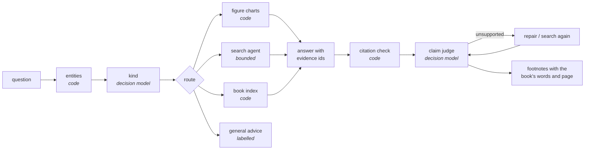

# Dance Style RAG


Ask a question about ballroom or Latin dance technique, and get an answer from the WDSF technique books (10 dances,
about 1,750 pages). **Every fact in the answer is cited to the book, and every cited claim is checked against its
source before the answer is shown.**

<!-- TODO: link to the live demo page and a short GIF of the "How the system answered" panel -->

It is a **constrained agentic RAG**:
- **Code** owns the control flow, a plain-Python state machine.
- **A small decision model** makes the multiple-choice and yes/no calls, with calibrated probabilities.
- **The LLM** only searches, with bounded tool budgets, and writes the answer from the evidence it read.

## What makes it interesting

- **Routing with probabilities, not prompts.** A decision model classifies each question (figure, comparison,
  technique, term, character, general advice, out of scope), and code rules correct it. A question that falls below
  the threshold takes an UNSURE route instead of a wrong one.
- **Retrieval chosen per question kind.** Figure questions read whole step charts by code. Term questions use the
  books' own index. Open questions get a bounded search agent that may only *collect* evidence, never answer.
- **Verification after writing.** Each claim in the answer is judged against the exact blocks it cites (supported /
  contradicted / not in evidence). Failing claims are repaired or searched for again, never shown as fact.
- **A parser chosen per page type.** The books defeat every single PDF parser. A comparison of six parsers on 15
  hard pages picked a combination: bibr for tables and charts, Docling for prose structure, and code that reads the
  colour-coded matrices from their pixels. It scored 1.73 vs 1.44 for the best single parser.
- **Measured decisions.** Prompts, search output and index designs were chosen by A/B tests with blind review. One
  example: a 55% shorter prompt set lost 88 vs 111.
- **A public demo that is safe to run.** It streams a whitelisted trace of every step, quotes at most ~200
  characters of book text, and has a daily budget cap, rate limiting and CORS for the demo site only.

## How a question is answered



Details: [docs/architecture.md](docs/architecture.md).

## Results

| | |
|---|---|
| Parser combination vs best single parser (15 hard pages, 0–2) | **1.73** vs 1.44 |
| Final index vs original (29 gold questions) | gold page cited **27/27** vs 23/27; unsupported claims **0** vs 1 |
| Routing on 100 draft questions | 84 right, 12 UNSURE, 4 wrong |
| Cost per question (cloud models) | about 1–2 cents |

More in [docs/evaluation.md](docs/evaluation.md) and [docs/decisions.md](docs/decisions.md).

## Stack

Python 3.11 · PydanticAI agents · Ollama / Ollama Cloud and Cerebras (gpt-oss) · a decision model through Ollama's
`/v1/systemone` · BM25 + bge-small embeddings with reciprocal rank fusion · bibr, Docling and PyMuPDF for parsing
· FastAPI (server-sent events) · Docker Compose + Caddy · uv · pytest · ruff · GitHub Actions

## Run it

The WDSF books are copyrighted and are **not** in this repository, and neither is anything built from them. Without
them you can run the lint and the unit tests:

```bash
make setup        # uv sync: the locked environment
make lint
make test         # tests/unit always; tests/index only when the index is built
```

With your own copies of the books in `theory/latin/<Dance>.pdf` and `theory/standard/<Dance>.pdf`, you need an
Apple Silicon Mac (bibr's table OCR runs on MLX), [uv](https://docs.astral.sh/uv/), [Ollama](https://ollama.com)
and `brew install libmagic`:

```bash
make setup-docling setup-bibr     # two separate parser environments
make extract                      # bibr + PyMuPDF + the books' index pages (cached; ~10-15 min per book)
make docling                      # Docling on the ~525 prose pages (cached; ~30-45 min the first time)
make build                        # the index: cache/agentic/index_v4 (~1 min)

make ask Q="How do I dance the Fan in Rumba?"     # one question with a full trace
make web                          # trace viewer: http://127.0.0.1:8765
make eval                         # gold-question evaluation (cloud models cost money)
make api                          # the public API on :8080 (deploy: docs/deploy.md)
```

Models are set in `dance_rag_agentic/settings.toml`. The default is cloud: `gpt-oss:120b` + `clef`, which needs
`ollama signin`. The free local pair is `make models` (`gpt-oss:20b` + `pplx-decider-flash:4b`).

## Repository

```
dance_rag_agentic/
  ingest/        reading the books and building the index
  retrieval/     read-only access to the index: sections, charts, hybrid search, outline
  agent/         the graph, agents, tools, evidence ids, claim checks, prompts
  apps/          public API, command line, trace viewer
  evaluation/    gold-question evaluation
tests/           unit (no books needed) and index tests
deploy/          Dockerfile, docker-compose, Caddy example
examples/widget/ the demo page widget (vanilla JS/CSS) with a local preview
docs/            architecture, decisions, evaluation, parser comparison, deployment, limitations
```

No license: the code is shown for reading. All rights reserved.
