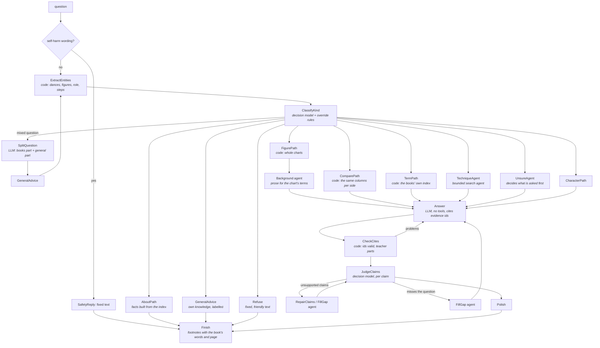

# Architecture

The system answers dance technique questions from the WDSF technique books. It is a **constrained agentic RAG**:
- **Code** owns the control flow, a plain-Python state machine (`agent/graph.py`).
- **A decision model** makes the multiple-choice and yes/no calls (what kind of question this is, whether a claim
  is supported) and returns probabilities.
- **The LLM** only searches, inside bounded tool budgets, and writes the answer from the evidence it read.

Every fact in an answer carries an evidence id, and every cited claim is checked against its source before the
answer is shown.

## How a question flows



| Step | Who | What |
|---|---|---|
| ExtractEntities | code | Fuzzy match against the books' own figure and dance lists, plus role and step numbers. Figure detection stays in code: the decision model missed 7 of 22 figures, code found 41 of 42 |
| ClassifyKind | decision model + rules | kind + aspect (timing, footwork, lead, ...). Override rules: no figure named → no figure kinds; two figures, dances or roles → comparison; top probability below 0.5 → UNSURE |
| FigurePath / ComparePath | code | read the whole figure chart (both sides + NOTES) for each figure, role and dance asked |
| Background | agent (≤ 6 tool calls) | reads the prose that explains the chart's own terms (positions, actions, lead) |
| TermPath | code | the books' own index plus headings named in the question; no hit → TechniqueAgent |
| TechniqueAgent / UnsureAgent | agent (≤ 15 tool calls) | free search with the toolbox; agents only *collect* evidence, they never answer |
| Answer | LLM, no tools | writes from the evidence it is given, citing ids like `[123456.3]`; always three parts: *what it is / how to do it / what to watch* |
| CheckCites | code | ids valid and listed (ranges are expanded by code), no uncited fact lines, teacher parts present, no retyped chart. Max 2 rewrites |
| JudgeClaims | decision model | each claim vs the blocks it cites: SUPPORTED / CONTRADICTED / NOT_IN_EVIDENCE (accepted from p ≥ 0.7). Then: does the answer respond to the whole question? |
| RepairClaims / FillGap | LLM + agent (≤ 3 tool calls) | rewrite or remove only the failing claims, or search evidence for exactly those claims. Max 2 repair rounds; a rewrite that breaks citations is dropped for the last good answer |
| Finish | code | evidence ids become footnotes with a quote and page; general advice is shown apart, under its own heading |

## Evidence ids

Every section of the index has a stable 6-digit id derived from its content key (`Rumba|chart|Fan|Lady|side 1`),
so a rebuild keeps the ids. Its citable blocks are numbered: `[123456.3]` is block 3 of section 123456. A chart side
is one block, and the step is named in the text. Step-level ids caused off-by-one errors and rewrite loops.

## The toolbox: one set of functions, two callers

Graph nodes call `retrieval/books.py` directly (a fixed route, the same every run). Agents call the same functions as
tools (`agent/tools.py`) when they see a reason to:

| Tool | What it does |
|---|---|
| `search(query, dance, kind)` | hybrid search: BM25 + embeddings fused with reciprocal rank fusion. One line per matching figure, text hits with where they live, their size and the sentence that matches |
| `outline(dance[, section_id])` | the book's table of contents with section ids and sizes |
| `read_section(section_id)` | reads a whole heading unit (a chapter with its subheadings, up to 5,000 characters) into the evidence |
| `list_figures`, `dances_with_figure`, `select_charts`, `read_charts` | figure charts, read whole |

Tool rules: the docstring is the prompt (it says *when* to use the tool), errors come back as text so the agent can
retry, and only sections read through a tool become citable evidence. Search hits are snippets, not evidence.

## Code layout

```
dance_rag_agentic/
  config.py, settings.toml  paths, models, thresholds (settings.toml: the user-facing choices)
  ingest/                   offline: bibr, PyMuPDF, Docling, matrix colours -> build_index.py -> cache/agentic/index_v4
  retrieval/                read-only index access: index.py (loader), books.py (sections, charts, search), outline.py
  agent/                    graph.py (State + nodes + run loop), agents.py, tools.py, evidence.py, checks.py,
                            decision.py, entities.py, prompts.py, safety.py, models.py, usage.py
  apps/                     api.py (public API), cli.py, web.py (trace viewer), static/
  evaluation/               evaluate.py, gold/ (spec + validator)
tests/unit                  no model, no index (CI)
tests/index                 no model, needs the built index
```

## Models

| Role | Used for | Default | Local alternative |
|---|---|---|---|
| answer | searching agents and writers | `gpt-oss:120b` (Ollama Cloud, or Cerebras for speed) | `gpt-oss:20b` |
| decision | kind/aspect choices, yes/no checks, claim judge | `clef` (Ollama Cloud, `/v1/systemone`) | `pplx-decider-flash:4b` |

Settings: `settings.toml` sets the defaults. Environment variables (`DANCE_RAG_AGENTIC_ANSWER_MODEL`,
`DANCE_RAG_AGENTIC_DECISION_MODEL`) override it, and CLI flags (`--answer-model`, `--decision-model`) override both.
Every command first checks that the models exist and have the needed capabilities
(`python -m dance_rag_agentic.agent.models` lists them). Each run logs the tokens and cost of every model call.

Local models: set the Ollama context length to about 32k. With the default 131k, the two models evicted each other
from memory. Run one local model job at a time.

## The trace viewer

`make web` (http://127.0.0.1:8765) asks a question and shows every node as it works. You see timings, tokens, the
decision model's probabilities as bars, tool calls, and judged claims. Then it shows the answer with its sources as
tables. You can attach notes to a run or a step, and every run is saved in `cache/agentic/traces/`.

The agents' reasoning (gpt-oss thinking, per model call) is saved in those trace files only: `│ thinking (…)` blocks
in the `.log`, `thinking` events in the `.jsonl`. It is never printed, never shown in the viewer, and never sent to
the API's visitors.

## The public API

`apps/api.py` (FastAPI, docs at `/docs`) streams what the system does as server-sent events: routing, tool calls,
sections read, claims and their verdicts, repairs. Then it sends the answer, with short source quotes. What is shown
is a **whitelist**: never book text beyond a ~200-character quote, never prompts, tool results or file paths. The API
also has a daily budget cap, a per-visitor rate limit and a short queue, and only the demo site's origin may call it.
Deployment: `docs/deploy.md`.

## Rules the code follows

- **No hand-typed book lists.** Dances and styles are read from the index, so a new book appears in every prompt.
- **Agents collect, they do not answer.** Only sections read through a tool become evidence.
- **Citations are listed, never ranged.** Code expands short ranges itself instead of asking for a rewrite.
- **No role named means both roles.** The answer gives each partner's part.
- **Answers teach.** The direct answer comes first. A "how do I dance figure X" question gets a short guide, not the
  chart retyped: the chart tables are shown below the answer.
- **"Not found in the books" means not covered**, not impossible. When the books state the opposite of the question's
  assumption, the answer corrects the assumption.
- **A failing decision model does not crash a run**: one retry, then the graph carries on and warns.
- **Measured, not guessed.** Thresholds and tool budgets come from eval runs (`docs/decisions.md`).
